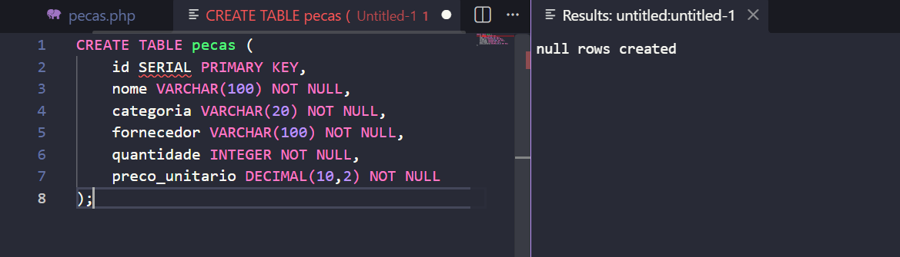
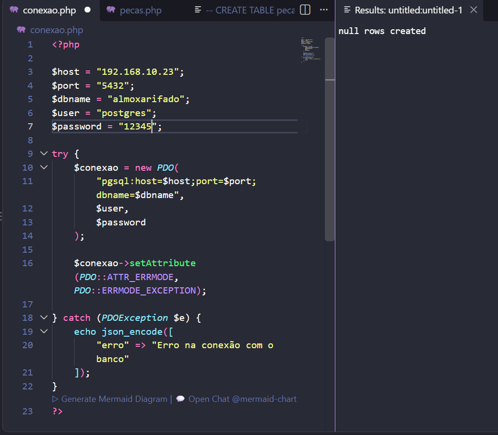
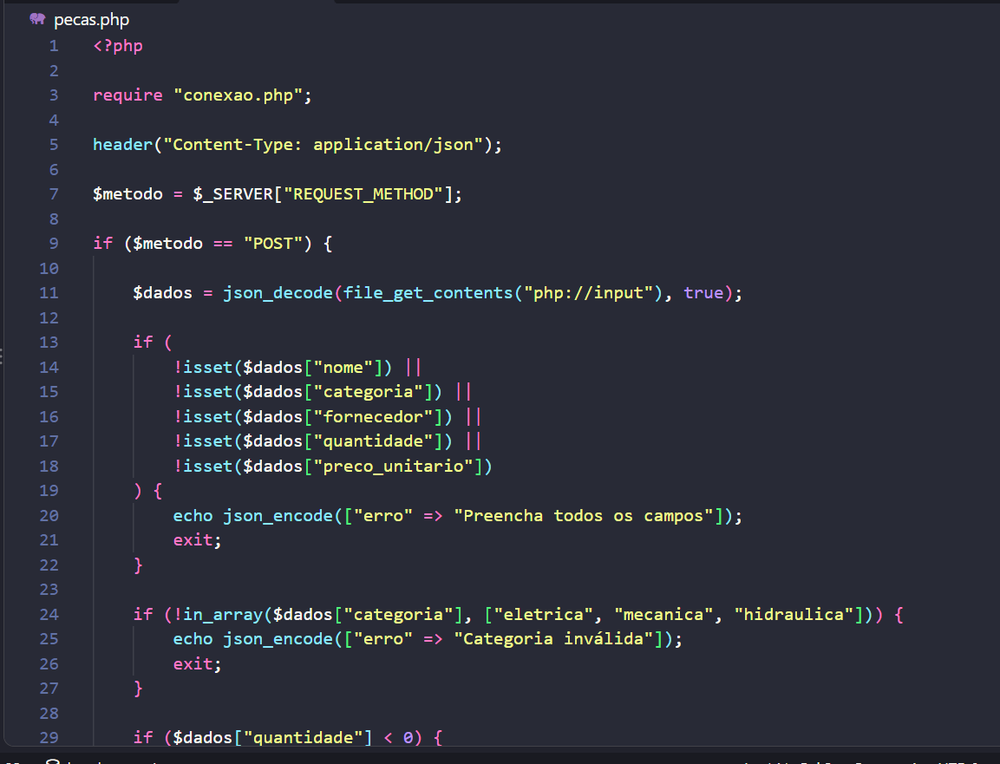
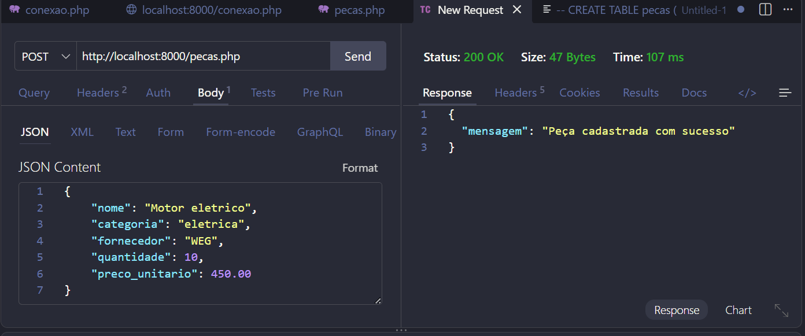
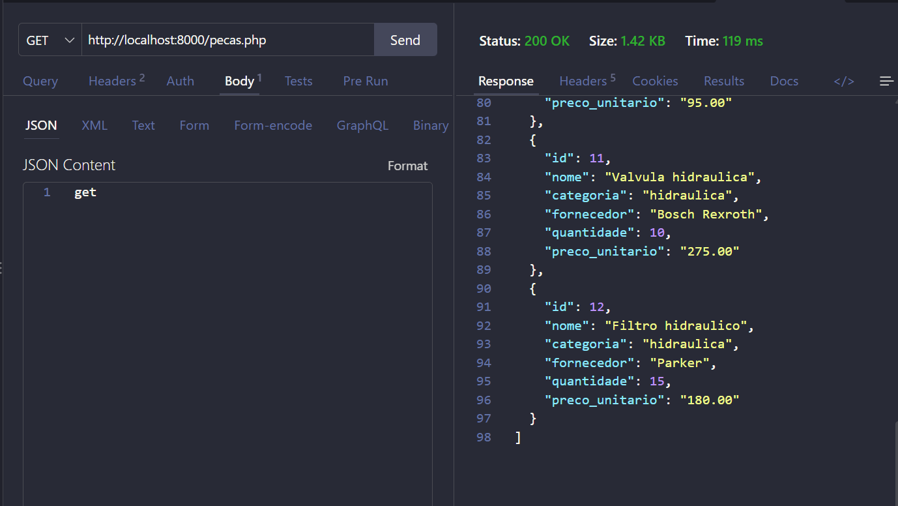
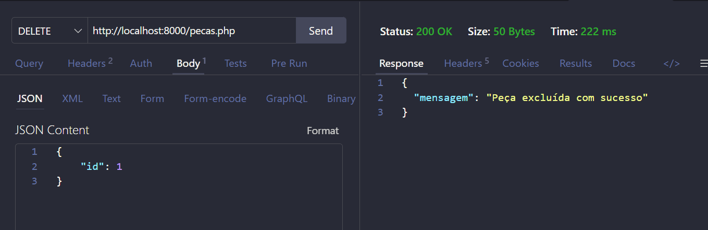
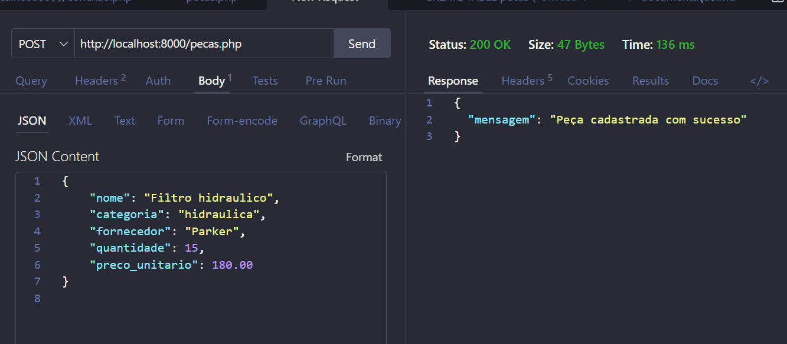

depois fiz a conexao com o conexao.php


Agora configurei o pecas.php


testei o POST e deu certo


O GET


DELETE


coloquei 12 produtos



quanyas unidades existem no almoxarifado?
```sql
SELECT SUM(quantidade) AS total_unidades
FROM pecas;
```

Qual o valor total do estoque?
```sql
SELECT SUM(quantidade * preco_unitario) AS valor_total_estoque
FROM pecas;
```

Preço da peça mais cara
```sql
SELECT MAX(preco_unitario) AS maior_preco
FROM pecas;
```

Preço médio com duas casas decimais
```sql
SELECT ROUND(AVG(preco_unitario), 2) AS preco_medio
FROM pecas;
```

Valor total em estoque somente da categoria elétrica
```sql
SELECT SUM(quantidade * preco_unitario) AS valor_total_eletrica
FROM pecas
WHERE categoria = 'eletrica';
```